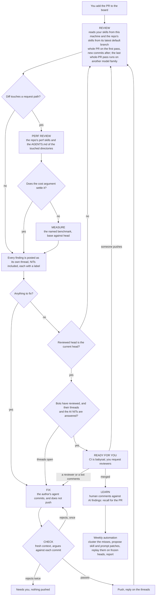
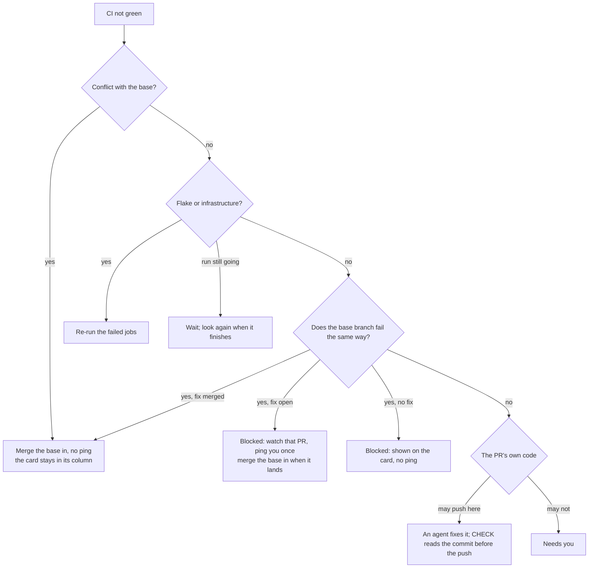

# bb-plugin-review-desk

Review GitHub pull requests inside bb: a document-style PR page with the diff, the conversation, inline comment authoring, and a chat with an analyst that has the code in front of it.

## What it does

- **PR factory**: you add a PR to the board, and that starts one loop: AI review of every pushed head, fixes by the author's agent on your own PRs, a check of each fix before it is pushed, and review again, until the reviewed head is the current head. Then it is ready for you. See [The PR factory](#the-pr-factory).
- **Slack bridge**: one channel you pick is the factory's room. **Post to Slack** on a PR page (next to the head sha) gives that PR a thread whose root is its card: title, the stages of its lane with the current one in bold (`Review › *Fix and check* › Needs you › Ready`), CI, open threads, and what is happening now, repainted as it moves. Nothing is posted until you ask; **Stop** ends the updates and leaves what is there. The factory's events are replies in the PR's thread: each AI round with a table of its findings, each run of the author's agent as a plan that goes from working to one task per verdict, each babysit action, and hand-offs, which are the only replies that mention you. Talk in a PR's thread and the PR's agent answers there: on your PR the `#N · PR` thread on its branch, on others' the read-only analyst. An @mention or DM anywhere else starts a bb thread in `slackProject` with the Slack thread so far. Every turn from Slack runs on `slackModel`. Several people can be in a thread: each message reaches the agent with its sender's name, side talk not addressed to it is passed with "answer only if it is for you", and the agent may answer `<silent/>`, which posts nothing. Plain words are handled before any model: `(aside) …` is ignored, `mute` / `unmute` silence a thread except for @mentions, `stop` stops the agent, and in a PR thread `babysit`, `fix`, `deslop`, and `review` act on the PR. It uses Socket Mode, so bb needs no public URL; `slack-app-manifest.yaml` creates the app.
- **The board** is the landing page: paste a PR link and it becomes a card under **Unreviewed** (no review has started), **AI review**, **Human review**, **Changes requested** (a reviewer asked for changes), or **Babysit** (approved by you or others: the decision, or any reviewer's latest review; now you watch CI until it merges). Drag a card to hold it elsewhere until GitHub's state changes, then it follows GitHub again. A card shows the title, `owner/repo #N`, the author, when GitHub last saw activity, and chips for what is in the way: checks passed/total (red when one fails), unresolved threads, approvals, reviewers asking for changes, merge conflicts, and your pending comments. A Babysit card leads with CI: a bar of passed checks, the failing checks by name linking to their runs, one verdict chip (merge conflicts, CI failing, CI running, needs a required review, still a draft, or ready to merge) and when the last commit was pushed. Merged and closed PRs leave the columns and fold into a strip under them until you remove them. Click a card for the PR page below. Open PRs are synced with GitHub when the board opens if they are more than ten minutes stale, on **Refresh**, and in the background on the `boardRefresh` cron; a sync skips the git fetch when the head did not move.
- **Open a PR** by URL or `owner/repo#123`. The host entry finds the local checkout among your bb projects (or clones it), fetches the PR head, and keeps a detached worktree under `~/.review-desk/worktrees` on that machine (or `worktreesDir`), outside bb's data dir so the chat and helper threads can run in it.
- **PR page**: state, title, author, base and head branches, then three tabs: **Map** (first and default), **Diff**, and **Comments**. Diff holds the commits and the changed files as cards; files load lazily as you scroll, and viewed marks and a "lines left" counter track progress. Comments holds the description and the discussion (reviews, comments, open threads).
- **Diff** per file with Pierre diffs: split by default (unified on request), long lines wrap instead of scrolling sideways, syntax highlighting from bb's code theme, expandable context, line selection. Every file starts collapsed; **Expand all** opens the unviewed ones.
- **Map** tab: a [diffmap](https://github.com/tanishqkancharla/diffmap) of the PR, a walkthrough with diagrams, call stacks, and code linked to the diff, written by the hidden helper thread with diffmap's own `generate-diffmap` skill (bundled under `skills/`). Written when a PR is added and again at each new head once you have one (`autoMap`); Rewrite at any time. An older map stays on screen, marked stale, while a newer one is written.
- **Commits you can open**: click a commit in the Diff tab's Commits list for its diff against its first parent (position, Older and Newer, full message, GitHub link); shift-click a second commit to diff the range between them. The review remembers the head you last opened it at, marks newer commits "new" with a divider at your last position, and offers "Diff the N new commits since you last looked". Commit views are read-only apart from the chat: select lines to ask about them as they were at that commit (a pill pinned to the sha), `@` a commit by sha or title, and use Comment at head to jump to the same lines in the PR diff.
- **GitHub threads inline**, anchored to their lines, with reply and resolve. Comment cards use the app font, wrap, render `<details>` as collapsibles, and carry chips for the PR author, bots, severity, and finding ids.
- **Simple English**: every GitHub comment (inline threads, conversation comments, review bodies) can flip to a plain rewrite written by a second hidden thread: what the author wants first, then only the facts needed to act, sentences of at most 12 words, words a twelve-year-old knows, code kept byte for byte, at most a third of the length. Each comment has its own **Simple English** / **Original** switch and starts on the original. In the default lazy mode a comment is rewritten the first time you flip it (a few seconds on a fast model); eager mode rewrites every comment as it loads. An edited comment is redone, everything else is served from SQLite.
- **Comments**: select lines and press Comment, or use the gutter button. Comments stay pending until you submit one review from the Info tab as comment, approve, or request changes. Nothing reaches GitHub without that click.
- **Private notes**: comments only you see, shown inline with an amber dashed edge. Two sources: **Find slop and cleanups** (Notes menu above the changes) has the helper read the diff and leave up to 25 notes with kind (slop, cleanup, risk, question), severity, and sometimes a suggested rewrite; and **Keep private** on the comment composer. Each note can be dismissed, promoted to a pending GitHub comment (a suggestion becomes a `suggestion` block), sent to the chat as a pill, or sent to the council. Notes carry a content hash of their line and follow it across pushes; ones whose line is gone are marked stale.
- **Chat with the PR**: the Chat tab hosts one analyst thread per provider, spawned into the PR worktree and read-only by instruction, rendered with bb's own thread view. The first message comes from bb's new-thread composer (pick provider and model there; the environment shown is ignored, the analyst always runs in the PR worktree); later messages go through the thread's own composer. Message actions turn an answer into a pending comment on the selected lines or send it to a Roundtable room.
- **Code pills**: code goes into the chat as @-mention pills that resolve to text when you send, so the transcript stays short and the analyst gets the excerpt. Three ways in: select lines in the diff and press `a` or **Add to chat**; type `@` in the composer to search changed files, commits, GitHub review threads, the PR description, or an explicit `path:10-20`; or pick **Summarize in chat** on a file card. A banner above the composer shows the current diff selection with its own **Add to chat**.
- **Info** tab: checks with a progress bar, reviewers with their state, assignees, labels, and the pending review.

## The PR factory

Nothing reaches the board on its own: you add a PR (paste its link, or `bb review-desk open`), and adding it starts the loop. The factory never marks a PR ready and never requests reviewers; it stops at "ready for you".



The stages:

| Stage | When | What it does | Prompt | Thread |
|---|---|---|---|---|
| REVIEW | every head, once it has sat still for `aiReviewSettleMinutes` (at once after the author's agent pushes) | Round 1 covers the whole PR. Later rounds cover what the PR changed since the last round and decide which earlier findings are fixed, open, or obsolete. Before the PR is first called ready, one more whole-PR pass runs on a new thread with fresh eyes, if commits landed since round 1. That pass runs on `finalPassProvider` / `finalPassModel` (GPT-6-Astra on Codex by default), with the same prompt and the same read-first list, so a second model family looks before you do. The server posts a COMMENT review per round: every finding as its own inline thread, labeled BLOCKER, BUG, PERF, TEST, DESIGN, QUESTION, or NIT; only findings outside the diff go in the body. Nothing is filtered or refuted before it is posted. | `prompts/review.md` | AI review |
| PERF REVIEW | after a round's review, when the code that round covers is on a request path: a changed file sits under a directory whose `AGENTS.md` has a `## Performance` section, or the reviewer, who has just read the diff, says so (its reply carries `perf.needed` and a reason). No list of paths is kept in the plugin | The reviewer argues the cost per request, token, event, or connection against the base branch, at the repository's default limits. It measures only when the code does not settle it, and reports the finding either way. Posted as its own review. | `prompts/perf.md` | AI review (same thread) |
| FIX | your own PRs: after a round with something to fix, after a reviewer's or your comments, and for a CI failure the PR causes | The author's agent pulls every comment fresh, judges each (FIX, SKIP, ASK), and commits fixes without pushing. When the rounds first converge it also deslops the diff once. | `prompts/fix.md` | Author's agent |
| CHECK | before every push by the author's agent | A reviewer that has never seen the PR argues against each commit: does it fix what was asked, does it add work on a request path, does it add something unused, does its test fail without the fix, was the comment worth applying. A rejected commit goes back to the agent once; a second rejection comes to you and nothing is pushed. | `prompts/check.md` | Check (new each time) |
| Babysit | once the PR is ready or approved, and on every waiting PR the factory may push to | Gets CI green by itself: see [CI babysitting](#ci-babysitting). | `prompts/babysit.md` plus the repository's guide in `ci/` | CI babysit |
| LEARN | after a merge | Writes every human comment and every AI finding to telemetry, and matches them: found, demoted (seen and lost), or missed, with the cause of each miss. | `prompts/learn.md` | Learn |

On someone else's PR there is no FIX: rounds run on each push until nothing above a NIT is open or a push changes nothing, then the PR comes to you in **Your review**. Your review moves it on: an approval to **Babysit**, anything else to **Changes requested** until the author pushes, which sends it through a round and back to you.

### Before a PR is ready: bots and NITs

On your own PR the loop does not call a PR ready while a bot's review thread is open. When the rounds converge it first waits until the head has been up for `botSettleMinutes` (bot reviewers such as CodeRabbit post a few minutes after a push; a bot check that is still running extends the wait). Then every unresolved thread a bot opened, and every AI review NIT, goes to the author's agent in one run: it reads the code the comment points at, fixes it or says why not, replies, and resolves the thread, and its commits pass CHECK like any other. A push sends the PR through a round and back to this gate. If a bot's thread is still open after the agent answered at that head, the PR comes to you in Needs you. Once a PR is Ready, a bot review that arrives later starts the same run.

### CI babysitting

The babysitter's job is to get CI green without asking. Each pass reads the failing checks with the repository's CI skills and its guide, and picks one outcome:



- **Per repository.** `factory-skills.json` gives each repository a `babysit` list (its CI skills) and a `ci` entry: `guide`, a file in `ci/` with that repository's rules, and `act`, whose PRs the factory may push to for CI: `mine` (your own) or `any` (every PR of that repository on the board). To add a repository, add its entry and a guide file.
- **SGLang** (`ci/sgl-project__sglang.md`, `act: any`): only `lint` and the base tier must be green, plus tests the PR description names; extra tiers and opt-in gates are expected failures. The factory merges main in and makes small CI fixes on teammates' PRs, because you maintain the repository.
- **Dynamo** (`ci/ai-dynamo__dynamo.md`, `act: mine`): a conflict is always merged in, in any column, without a ping.
- **Pings.** You are told once per cause: when a fix exists on the base repository and is not merged, when only a person can decide, or when the pass budget runs out. The same cause is never pinged twice, and a head pings at most once in three hours. In Slack, babysit actions repaint one message in the PR's thread instead of adding replies.

### The board

| Column | My PRs | Reviewing |
|---|---|---|
| Review | a round is queued or running, or the PR waits for a push | the same |
| Fix and check | the author's agent is working; the card says which step (working, commits being checked, revising, pushing) | not used |
| Needs you / Your review | only you can unblock it: a question from the agent, a commit the check rejected twice, a job that stopped | AI review is done at the current head; your turn |
| Changes requested | not used | you asked for changes; waiting on the author |
| Ready / Babysit | reviewed at the current head; CI is babysat; you request reviewers when you want | approved; CI is watched until it merges |

A new push to a PR that is waiting, or a reviewer's comments on your own PR, sends it back through the loop. Dragging a card into Review starts a round now; into Fix and check starts the author's agent; to Not started takes the PR out of the factory. A card dragged elsewhere in the first `startDelaySeconds` after you add it follows the column you chose instead.

### Where prompts and skills live

- **Prompts** are plain files in `prompts/`, one per stage, and hold process only: what the stage does, in what order, and what it must output. Sections inside a file start at a `<!-- @name -->` line. A prompt's version in telemetry is the hash of its file.
- **The skills map** is `factory-skills.json`. For each stage it names the skills to read: `personal` (your own, by name) and, per repository, `review`, `perf`, `measure`, `fix`, `check`, and `babysit`, plus `ci`. It holds skill names and policy only, never paths. A fork says `sameAs` and reads its upstream's.
- **Your skills** are read from this machine as they are now (`~/.claude/skills/<name>/SKILL.md`).
- **The repository's skills and `AGENTS.md` files** are read from its latest default branch, fetched before every job and exported to `~/.review-desk/skills/<owner>__<repo>/<sha>/`, so a job never reads a stale copy from the PR branch. A repository with `reviewByTopic` has topic skills instead of one review skill: the reviewer gets every skill's description and reads the ones that fit the diff.
- Each prompt starts with a "Read first" list of those files, built by the server, and the reply names the ones that were read. Telemetry records the list with each file's digest.

Where a lesson goes: a rule for one repository belongs in that repository's `AGENTS.md` or skills; a rule that holds anywhere belongs in your own skills; when or what to review belongs in a prompt.

### Learning

Every job goes to `~/.review-desk/telemetry/events.jsonl` (and from there to MLflow) with its prompt, prompt version, skills, and trajectory. After a merge, a `pr_closed` record holds the humans' comments and the AI findings, and a `recall` record holds the match. The weekly automation follows `skills/factory-learn/SKILL.md`: it clusters the misses, writes proposed changes as patch files, replays each on frozen PR heads (`~/.review-desk/learn/replay-set.json`), and reports to `~/.review-desk/learn/<date>/report.md`. It lands nothing; you approve.

A turn that ends without its reply block (the agent stopped to wait on a background build or test) no longer fails the job: the job stays open, the thread is told to wait in the foreground if it is still idle a few minutes later, and only two such turns in a row fail it.

## Layout

- `host-contract.ts` — RPC contract between server and host.
- `host.ts` — runs on the machine with the repository: git worktrees and diffs, `gh` for PR data and review submission.
- `server.ts` — SQLite store (reviews, viewed files, GitHub caches, pending comments, notes, chat seats, maps), RPC for the UI, `bb review-desk` CLI.
- `app.tsx` — the **Reviews** nav panel; fixed tabs **Info** and **Chat**; the composer banner that receives pills.
- `board-spec.ts` — the board's columns and their labels, shared by server and app.
- `factory-spec.ts` — the PR factory's labels, reply parsing, thread intros, and the GitHub review body, shared by server and app.
- `prompts/*.md` — the factory's stage prompts: `review`, `perf`, `fix` (with its revise, publish, deslop, and CI sections), `check`, `babysit`, `learn`.
- `ci/*.md` — one CI guide per repository, shown to the babysitter.
- `factory-skills.json` — which skills each stage reads, per repository, and the request paths that trigger a perf review.
- `factory-prompts.ts` — loads the prompt files and the skills map, and builds each stage's prompt (server only).
- `factory-skills-host.ts` — on the repository's machine: finds your skills, and exports the repository's skills and `AGENTS.md` files from its latest default branch.
- `slack-client.ts` — Slack Web API calls and the Socket Mode connection, with no SDK.
- `slack-blocks.ts` — the Slack bridge's Block Kit: PR cards and the factory's replies.
- `slack-app-manifest.yaml` — the Slack app the bridge needs.
- `board.tsx` — the board page: columns, cards, drag and drop, the merged-or-closed strip.
- `lib/format.ts` — `timeAgo` and `describeError`, shared by the review page and the board.
- `mention-ref.ts` — pill identity shared by server and app (what a pill points at, how its id is encoded, its label).
- `skills/review-desk/SKILL.md` — instructions the analyst threads receive.
- `skills/factory-learn/SKILL.md` — the weekly procedure that turns recall records into proposed skill and prompt changes.

## Develop

```
npm install
bb plugin install .      # builds server, app, and host bundles and registers the directory
bb plugin reload review-desk
npx tsc -p .
bb plugin logs review-desk
```

Requires `gh` authenticated on the machine that holds the repository.

## CLI

```
bb review-desk open <url | owner/repo#N>
bb review-desk list
bb review-desk board
bb review-desk move <reviewId> <unreviewed|ai_review|fixing|human_review|changes_requested|babysit|auto>
bb review-desk refresh
bb review-desk factory <start|stop|show|ping|resolve|fix|deslop|report|learn|prompt> <reviewId>
bb review-desk ask <reviewId> <text...> [--provider <id>]
bb review-desk map <reviewId> [--rewrite]
bb review-desk slack <reviewId> [on|off|show]
```

## Settings

- `defaultProvider` (default `claude-code`): the analyst preselected in Chat and used by the CLI.
- `hideSeatThreads` (default true): keep analyst and helper threads out of the sidebar.
- `autoMap` (default true): write the PR's diffmap when it is added to the board, and again when it is viewed at a new head.
- `helperModel` (default empty): model for the helper thread that writes the map and finds notes; empty uses the project's remembered default, which is what the analyst seats use too.
- `simpleEnglishMode` (default `lazy`): `lazy` rewrites a comment when you flip it, `eager` rewrites every comment as it loads, `off` hides the switches; `bb review-desk simple <reviewId>` queues a whole review in any mode.
- `simpleEnglishProvider` (default empty): provider id for the Simple English thread; empty uses `defaultProvider`. Changing it replaces the review's live Simple English thread on the next batch.
- `simpleEnglishModel` (default empty): model for the Simple English thread; empty uses `helperModel`, then the project's default. A small, fast model is enough, for example `acp-devin` with `swe-1-7-lightning`.
- `simpleEnglishSkill` (default empty): optional file appended to the rewrite prompt as vocabulary help, for example a `simple-english` SKILL.md. Empty uses a short built-in word list. A long rule set makes a fast model paraphrase instead of shorten, so the default is the short list.
- `boardRefresh` (default `*/15 * * * *`): cron (5 fields, server-local time) for syncing the board's open PRs with GitHub in the background; empty turns it off.
- `autoAiReview` (default true): adding a PR to the board starts the factory. Rounds post COMMENT reviews under your `gh` login. Nothing is added to the board for you.
- `aiReviewProvider` / `aiReviewModel` (default `claude-code` / `claude-fable-5-2`): the AI reviewer. `factoryReasoning` (default `xhigh`): the reasoning level for the reviewer, the author's agent, and the check.
- `finalPassProvider` / `finalPassModel` / `finalPassReasoning` (default `codex` / `gpt-6-astra` / empty): the whole-PR pass with fresh eyes before a PR is first called ready. Empty provider uses the reviewer's. If that provider cannot start, the pass runs on the reviewer's model.
- `botSettleMinutes` (default 10): how long a head must have been up before your PR is called ready, so bot reviewers have posted; 0 turns the wait off.
- `aiReviewMaxRounds` (default 6): safety cap on AI rounds in one loop (from a new head until the PR is ready again); the loop normally ends sooner, when a round leaves only nits or makes no progress.
- `perfReview` (default true): run the perf review when a round's files touch a request path.
- `checkCommits` (default true): check the author's agent's commits before they are pushed. `checkModel` (default `claude-fable-5-2`): the check's model; a different model than the agent's catches more.
- `reviewBots` (default `coderabbitai,dynamo-review-agent,copilot-pull-request-reviewer,github-actions,codecov`): logins that are bots. A review from anyone else on your own PR goes to the author's agent at once; a bot's threads are answered at the gate before the PR is ready.
- `aiReviewConcurrency` (default 2): rounds running at once across the board.
- `aiReviewSettleMinutes` (default 10): how long a new head must sit unchanged before the next round. Pushes are noticed on the `boardRefresh` cron.
- `aiReviewSkills` (default empty): extra skills the reviewer must read on top of `factory-skills.json`; comma separated, `owner/repo=skill` for one repository.
- `aiReviewEmpirical` (default false): let the reviewer run skills that build, launch servers, or run GPU or load tests. Off, it applies them by reading the code.
- `authorPipeline` (default true): on your own PRs, run FIX and CHECK. `fixerProvider` / `fixerModel` (default `claude-code` / `claude-fable-5-2`): the author's agent, which fixes feedback and merges the base.
- `deslopStage` (default true): deslop your PR once, when the rounds first converge; its commits are checked and reviewed like any fix. `deslopModel` (default empty, which uses `fixerModel`): the model for those turns, in the same thread.
- `babysitProvider` / `babysitModel` / `babysitReasoning` (default `claude-code` / `claude-fable-5-2` / `high`): the CI babysitter.
- `babysitMaxPasses` (default 10): babysit passes per head before CI failures are handed to you; re-runs and waits count.
- `slackBotToken` / `slackAppToken` (secrets, default empty): the Slack bridge's bot token (`xoxb-…`) and app-level token (`xapp-…`, `connections:write`). Create the app from `slack-app-manifest.yaml`. The bridge's settings apply live: it connects when both tokens are set and reconnects when any of them change.
- `slackChannel` (default empty): the channel id for the PR threads; invite the bot to it.
- `slackUserId` (default empty): your Slack member id. Hand-offs mention you, and you can steer the agents.
- `slackSteerers` (default `*`): who may steer the agents from Slack: `*` for everyone, or member ids, comma separated; anyone else's messages are context for the next turn.
- `slackModel` (default `claude-opus-5-5`): the model for every agent turn started from Slack.
- `slackProject` (default `proj_personal`): the bb project for conversations started in Slack outside a PR thread.
- `slackApiBase` (default `https://slack.com/api`): change only to test against a fake Slack.
- `slackWebhookUrl` (secret, default empty): a Slack incoming webhook. When set, every hand-off to you (Ready for you, Ready for you again, Needs you) also pings Slack with the PR link and why. `bb review-desk factory ping <reviewId>` sends a test to every configured sink.
- `slackMention` (default empty): put at the start of each ping, for example `<@U0123ABCD>`, so a channel webhook notifies you.
- `eventWebhookUrl` / `eventWebhookSecret` (default empty; the secret goes out as `X-Webhook-Secret`): every hand-off also goes here as JSON: `event` (`ready_for_you`, `ready_again`, `needs_you`, `test`), `headline`, `why`, `pr`, `factory`, and `checks`. Point it at a Devin automation's webhook trigger with a "Message session" action into one long-running Devin session synced to a Slack thread, and Devin relays each event to Slack and answers follow-up questions there.
- Review threads that surface (AI review, babysit) are titled by PR number, `#17712 · Ready for you`, and run in one shared environment per repository named after `threadSection`: a worktree of a tiny local repo under `<worktreesDir>/.groups/` that links each PR worktree as `pr-<number>`. bb folds threads into a folder only when two or more visible ones share a worktree environment, so they appear as a **Review Desk** folder inside the project once there are two.
- `threadSection` (default `Review Desk`): the sidebar section (folder) every thread Review Desk starts goes in, so chats, AI review, and babysit threads do not clutter the project; empty leaves them unsectioned.
- `worktreesDir` (default empty): directory on the repository's machine for the PR worktrees; empty uses `~/.review-desk/worktrees`. Keep it outside bb's data dir, or bb refuses to run the chat and helper threads there. Changing it moves each worktree on its next sync. Removing a PR from the board removes its worktree too, unless it has local changes.
